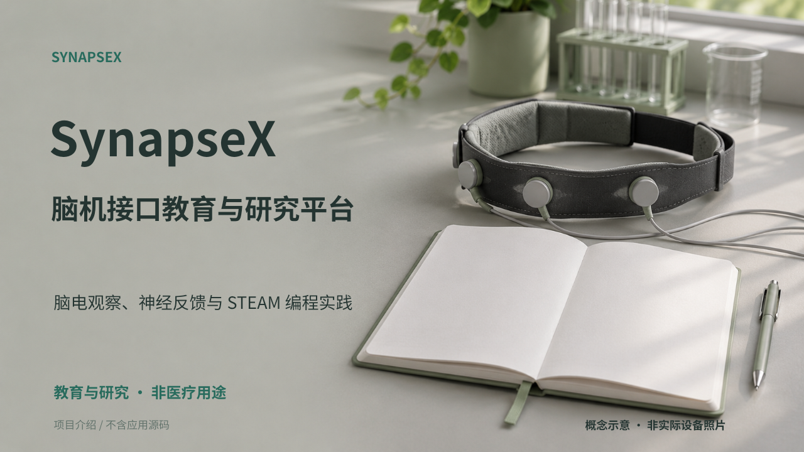

# SynapseX｜从脑电观察走向编程与仿真实践

> **把脑电变成可观察的反馈、可编程的输入和有目标的学习任务。**

SynapseX 围绕“观察信号—编写逻辑—完成任务—回顾过程”组织脑机接口学习。学习者结合本人的静息基线观察会话趋势，用 Blockly 或 Python 将脑机输入与 3D 场景交互相连，再围绕任务目标练习并查看检查反馈。具备匹配设备与运行条件时，实践路径可以延伸到实时采集和硬件联动。

*A brain-computer interface learning platform connecting EEG observation, personal-baseline feedback, Blockly/Python, 3D scenes and goal-based practice. For education and research.*

[阅读项目介绍 PDF](project-overview.pdf) · [下载公开版 PPT](project-overview.pptx)

## 从信号到实验的四个特点

| 特点 | 具体做法 | 带来的价值 |
| --- | --- | --- |
| **反馈围绕自己的基线展开** | 结合本人静息基线观察本次会话趋势，保留训练和学习记录。 | 便于理解自己的会话变化、回顾过程；不作人与人之间的能力排名。 |
| **脑机输入可以写进程序** | 使用 Blockly 或 Python 组织处理脑机输入的程序逻辑，与 3D 场景交互相连。 | 把输入、程序逻辑和场景响应放在同一次实践中观察。 |
| **探索带有任务目标和检查** | 围绕目标提交程序、记录进度；适用任务自动检查，其他任务由教师复核。 | 练习有明确目标，也有用于讨论与继续修改的反馈。 |
| **从仿真延伸到硬件实践** | 提供 3D 仿真与硬件编程路径，实时采集和联动依赖匹配的设备、固件与环境。 | 可按设备条件组织不同层次的学习实践，清楚区分仿真与真实信号。 |

## 适合怎样的学习实践

- 脑机接口入门：观察脑电与会话趋势，理解信号和反馈的关系。
- 跨学科编程实践：用 Blockly/Python 连接输入条件与 3D 场景。
- 任务教学与研究探索：围绕目标开展练习、记录过程并复核反馈。

## 实践流程

准备设备或仿真条件 → 观察反馈 → 编写程序与交互 → 任务检查与过程回顾

## 条件与范围

- **设备条件**：实时采集与硬件操作依赖兼容设备和运行环境。
- **教育研究**：不用于医学诊断、治疗或疗效判断。
- **示意边界**：概念插图不代表真实采集；不展示原始受试者数据。

实时采集与硬件联动的可用性与兼容设备、固件和运行环境有关。演示资料第 10 页展示竞赛流程构想，其中公示与申诉属于规划内容。

## 仓库内容

仅提供文字介绍、公开版 PPT/PDF 和静态封面图。配图中的概念示意与演示界面用于说明产品，不代表真实用户记录或实际实验结果。

本仓库不包含可部署的软件实现，也不授予底层软件的使用、修改或分发许可。展示资料的复用请先通过仓库 Issues 沟通。

## 项目入口与交流

- [GitHub 展示仓库](https://github.com/throwOctober/synapsex-bci-showcase)
- [Gitee 展示仓库](https://gitee.com/yifeiyin/synapsex-bci-showcase)
- [问题与交流](https://github.com/throwOctober/synapsex-bci-showcase/issues)

反馈请描述项目展示内容或使用场景，不需要提供私人联系方式。
